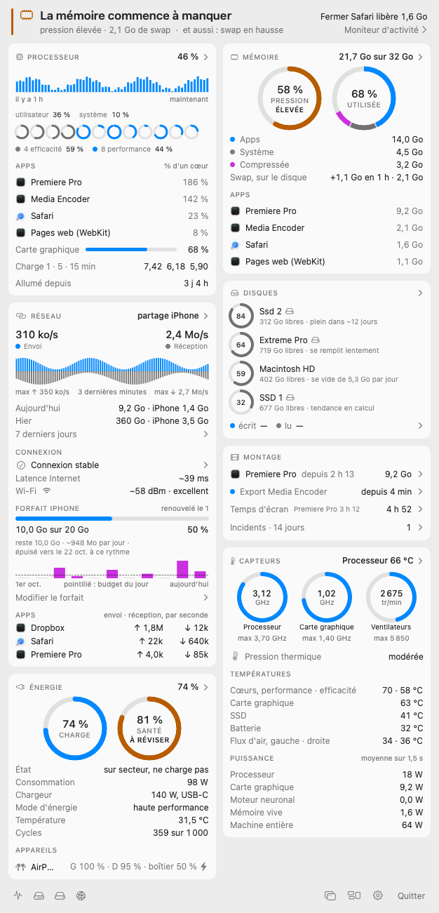
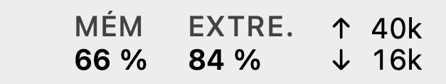
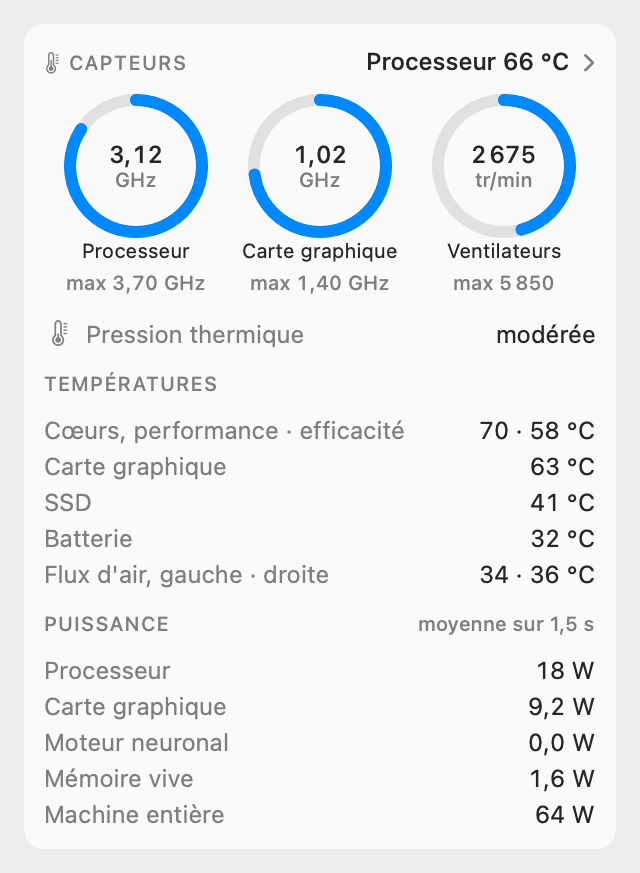
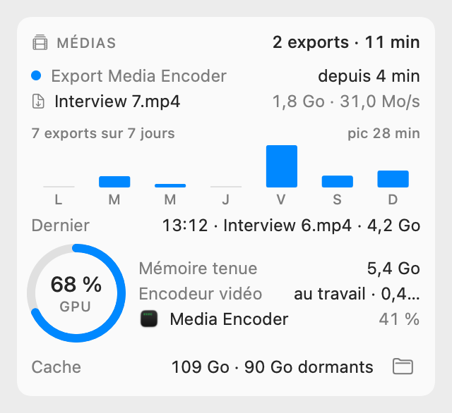

<p align="center">
  <picture>
    <source media="(prefers-color-scheme: dark)" srcset="images/panneau-sombre.png">
    
  </picture>
</p>

# Pulse

**Le tableau de bord de ton Mac, dans la barre de menus. Pensé pour les journées de montage.**

« 28 Go utilisés » ne veut rien dire. « La mémoire commence à manquer : fermer Safari libère 1,6 Go », si.
Pulse surveille la mémoire, les disques, le processeur, les températures, la batterie et la connexion,
et te dit en une phrase ce qui compte maintenant.

> Gratuit · Mac à puce Apple (M1, M2, M3, M4) · macOS 14 Sonoma ou plus récent · en français ·
> fait avec l'IA · non affilié à Adobe

<p align="center"><a href="#installer-en-30-secondes"><b>Installer</b></a> · <a href="https://github.com/Apocale/Pulse/releases/latest">Télécharger le zip</a> · <a href="#questions">Questions</a></p>

## Installer en 30 secondes

1. Ouvre le **Terminal** : `⌘` `espace`, tape *Terminal*, `Entrée`.
2. Colle cette ligne, puis `Entrée` :

   ```bash
   curl -fsSL https://raw.githubusercontent.com/Apocale/Pulse/main/installer.sh | bash
   ```

3. C'est tout. Pulse s'ouvre tout seul la première fois, puis vit en haut à droite de l'écran, dans la
   barre de menus :

<p align="center">
  <picture>
    <source media="(prefers-color-scheme: dark)" srcset="images/barre-sombre.png">
    
  </picture>
</p>

Un clic dessus ouvre le panneau. De n'importe où, même par-dessus Premiere en plein écran :
`⌃` `⌥` `M` (contrôle + option + M).

La même ligne installe les nouvelles versions. Elle ne fait que ça : vérifier ton Mac, télécharger
Pulse depuis cette page, vérifier son empreinte, le poser dans Applications et l'ouvrir
([le script, ligne par ligne](../installer.sh)).

<details>
<summary><b>Sans le Terminal</b> (quatre clics de plus, une seule fois)</summary>

1. Télécharge [Pulse.zip](https://github.com/Apocale/Pulse/releases/latest/download/Pulse.zip) et
   double-clique dessus.
2. Glisse **Pulse** dans le dossier **Applications**, puis ouvre-le.
3. macOS répond « Apple n'a pas pu confirmer que Pulse ne contient pas de logiciel malveillant ».
   Clique **Terminé**.
4. Ouvre **Réglages Système › Confidentialité et sécurité**, descends jusqu'à « Pulse a été bloqué »,
   clique **Ouvrir quand même**, tape ton mot de passe, puis **Ouvrir**.

Pourquoi ce détour : Pulse n'est pas notarisé par Apple, ce qui demande un compte développeur payant.
Installé par la ligne du Terminal, macOS ne pose pas la question.
</details>

## Ce que tu vois

| | |
|---|---|
| **La phrase du haut** | La seule chose qui compte maintenant, et de quoi agir : « Ssd 2 plein dans ~12 jours », « Fermer Safari libère 1,6 Go ». |
| **Processeur** | Chaque cœur, les apps qui le prennent, la dernière heure. |
| **Mémoire** | La pression (le vrai signal, pas les « Go utilisés »), le swap, les apps les plus lourdes. |
| **Disques** | La place libre, quand le disque sera plein à ce rythme, ce qui écrit dessus. |
| **Réseau** | Le débit, la consommation du jour, la qualité de la connexion, le partage iPhone. |
| **Montage** | Ta session Premiere, l'export en cours dans Media Encoder, les plantages. |
| **Énergie** | La charge et la santé de la batterie, le chargeur, tes AirPods. |
| **Capteurs** | Températures, ventilateurs, fréquences, puissance. |
| **Médias**, à allumer | Les exports de la semaine, la carte graphique, le cache média de Premiere. |

<table>
  <tr>
    <td><picture><source media="(prefers-color-scheme: dark)" srcset="images/carte-capteurs-sombre.png"></picture></td>
    <td><picture><source media="(prefers-color-scheme: dark)" srcset="images/carte-medias-sombre.png"></picture></td>
  </tr>
</table>

Le titre de chaque carte ouvre son historique, jusqu'à 90 jours. Tout se règle (clic droit sur l'icône
› Réglages) : les cartes, leur ordre, les colonnes, les couleurs, la barre de menus, des alertes.

<sub>Ces écrans sont dessinés par Pulse lui-même, sur une journée de montage inventée.</sub>

## Ce que Pulse ne fait pas

- **Il n'envoie rien sur internet.** Tout reste sur ton Mac, dans `~/Library/Application Support/Pulse`.
  Les deux options qui sortiraient (la météo, l'adresse IP publique) sont éteintes.
- **Il ne demande aucune autorisation au lancement** : ni mot de passe, ni accès à tes dossiers, ni
  localisation. macOS ne pose une question que si tu allumes toi-même le calendrier ou une alerte.
- **Il ne touche à rien.** Il lit. Il ne ferme jamais une app à ta place et ne supprime aucun fichier.
- **Il ne pèse rien** : moins de 1 % d'un cœur panneau fermé.

## Questions

**Mon Mac est compatible ?**
Un Mac à puce Apple (M1 ou plus récent) sous macOS 14 Sonoma ou plus récent. Pas les Mac Intel.

**Pourquoi passer par le Terminal ?**
Pulse n'est pas notarisé par Apple. Téléchargé par le navigateur, macOS le bloque une première fois ;
installé par la ligne, il s'ouvre directement. C'est exactement la même app.

**Il se lance tout seul ?**
Oui, à chaque ouverture de session, et macOS te le signale une fois. Pour l'en empêcher : Réglages de
Pulse › Général › Démarrage.

**Je ne monte pas sur Premiere.**
Pulse marche quand même : la carte Montage reste simplement calme.

**Comment je le désinstalle ?**
Clic droit sur l'icône › Quitter Pulse, puis mets **Pulse** à la corbeille depuis Applications. Ses
données sont dans `~/Library/Application Support/Pulse`.

**Et en anglais ?**
Pulse n'existe qu'en français pour l'instant.

**C'est sûr ?**
Tout le code est ici. Pulse ne demande pas de mot de passe, n'installe rien d'autre que lui-même et ne
lit que ton Mac.

## Fait avec l'IA

Pulse a été imaginé par Isma, monteur vidéo, pour ses journées sur Premiere Pro, et écrit avec
Claude Code, l'IA d'Anthropic. Chaque chiffre affiché se retrouve dans un relevé texte (`--probe`), et
chaque piège rencontré en route est noté dans le [README technique](../README.md).

## Pour les curieux

- Swift, SwiftUI et AppKit, sans Xcode : `./build.sh` compile et signe `Pulse.app`, `./verifie.sh`
  vérifie tout (tests, rendus comparés au pixel près, contraste des couleurs, coût processeur).
- `./.build/release/Pulse --probe` imprime le relevé de tous les capteurs.
- Le [README technique](../README.md) liste chaque mesure, sa source et les pièges vérifiés ; le journal
  des chantiers est dans [docs/chantiers](../docs/chantiers).
- `outils/distribue.sh` fabrique le zip de cette page, `outils/publie.sh` la met à jour.

---

<sub>**English.** Pulse is a free macOS menu bar system monitor built for video editors (Adobe Premiere
Pro), in French: memory pressure, swap, disks with a fill forecast, CPU per core, GPU, temperatures,
fans, battery, network. Apple Silicon, macOS 14 or later. Install:
`curl -fsSL https://raw.githubusercontent.com/Apocale/Pulse/main/installer.sh | bash`</sub>
